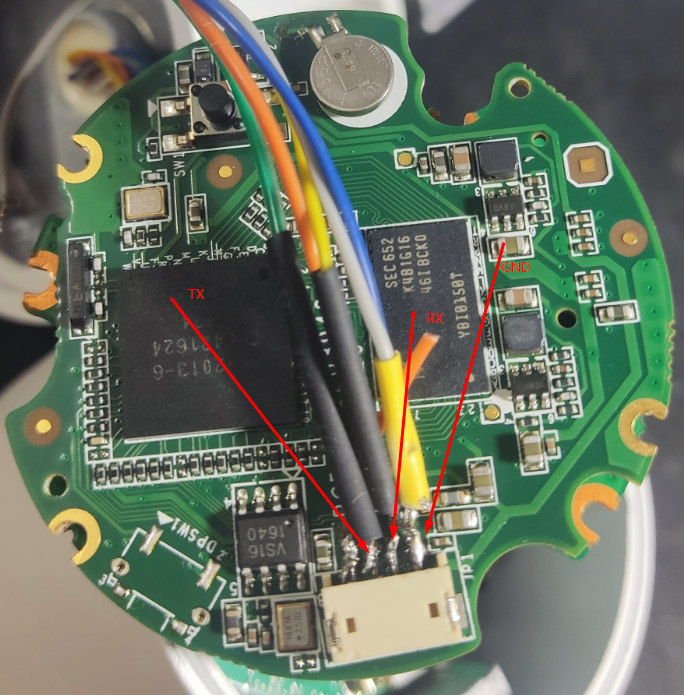

# Восстановление камеры HiWatch DS-I120 с прошивкой Ростелекома через UART, U-Boot и TFTP

> **Практический отчёт.** Восстановление камеры HiWatch DS-I120 2017 года выпуска. Дата проверки: 28 октября 2026 года.
>
> **Последовательность восстановления:** заводской U-Boot (`HKVS #`) → команда `update` → передача `digicap.dav` по TFTP → сообщение `Upgrade success!` → аппаратный сброс → статус `Inactive` в SADP.
>
> **Предупреждение.** Ошибка при записи прошивки может привести к отказу камеры. Описанные действия проверены на одном экземпляре DS-I120 и не гарантируют совместимость с другими аппаратными ревизиями. Перед началом работ необходимо проверить модель, загрузчик и происхождение образа. Выполняйте процедуру только на собственном оборудовании или с разрешения владельца.

## Введение и результаты восстановления

Исходное устройство — камера **HiWatch DS-I120 с объективом 4 мм**, операторской прошивкой Ростелекома и неизвестным паролем администратора. Локальные функции были ограничены. Цель работы — восстановить доступ к штатным сетевым службам без замены заводского загрузчика. В ходе проверки удалось:

- сохранить заводской загрузчик **без замены**;
- записать **HiWatch V5.4.81 build 190111** (вариант с удалённым `WebComponents.exe`) через штатную команду `update`;
- получить от U-Boot сообщение **`Upgrade success!`**;
- добиться запуска видеоподсистемы после проверки и повторного подключения внутреннего шлейфа;
- подтвердить работу сетевых портов **HTTP 80, RTSP 554 и Hikvision SDK 8000**;
- подтвердить ответ RTSP-сервера `200 OK` на `OPTIONS` и `401 Unauthorized` с поддержкой Digest-авторизации на `DESCRIBE`;
- сбросить старый пароль аппаратной кнопкой: в SADP камера перешла из **`Active` в `Inactive`**, а адрес сменился с `192.168.1.71` на `192.168.1.64`.

**Границы подтверждённых результатов.** На момент составления отчёта новый пароль в SADP ещё не был установлен и проверен. Получение изображения в VLC также не подтверждено. Открытый порт RTSP и ответ `401 Unauthorized` свидетельствуют о работе сервера и механизма авторизации, но не подтверждают передачу видеокадров.

---

## 1. Оборудование и условия проверки

| Компонент | Характеристики и средства проверки |
|---|---|
| Камера | HiWatch **DS-I120**, объектив 4 мм, экземпляр 2017 года |
| Исходная прошивка | Ветка **V5.4.3_170316**, операторская модификация Ростелекома |
| SoC | **HiSilicon HI3518CV100** |
| Оперативная память | **128 МБ** |
| SPI NOR | **Winbond W25Q128**, **16 МиБ** (`0x1000000`) |
| Заводской загрузчик | **U-Boot 2010.06**, приглашение `HKVS #` |
| Питание | Отдельный штатный источник **12 В** |
| Консоль | USB–UART на **CP210x**, логический уровень **3,3 В** |
| Компьютер | Windows, PuTTY, Python 3, SADP Tool, TFTP-сервер |
| Подключение к сети | Камера и компьютер в одной локальной сети Ethernet |

В ходе восстановления компьютер использовал адрес `192.168.1.117`, а камере в U-Boot временно назначили `192.168.1.10`. Эти значения приведены как пример. В другой локальной сети необходимо указать адреса из её подсети.

### Расположение разъёма UART

<!-- Перед публикацией добавить проверенную фотографию платы в images/ds-i120-uart.jpg. -->



**Подпись к рисунку (после добавления фотографии):**

> **Рис. 1.** Плата HiWatch DS-I120: сервисный разъём UART и подключение адаптера CP210x. После проверки распиновки на изображении следует обозначить контакты **GND**, **TX камеры**, **RX камеры** и при наличии **VCC / 3.3 V (не подключать)**. Для определения ориентации разъёма необходимо сохранить в кадре соседние элементы платы.

На исходном изображении платы виден белый четырёхконтактный разъём с обозначением `JP1`. Эта маркировка не определяет назначение контактов. Перед подключением адаптера необходимо проверить распиновку по работавшему соединению или измерениям. Распиновка другой ревизии платы может отличаться.

### Подключение USB–UART

```text
USB–TTL CP210x (3.3 V)       Камера DS-I120
------------------------------------------------
GND                 ───────  GND
TXD                 ───────  RX камеры
RXD                 ───────  TX камеры
VCC / 3V3 / 5V      ──X───  НЕ подключать

Отдельный блок питания 12 В ──> штатный вход питания камеры
```

- Используйте **TTL-UART с логическим уровнем 3,3 В**. Интерфейс RS-232 с другими уровнями напряжения не подходит.
- **Не подавайте 5 В** на сигнальные контакты камеры.
- **Не соединяйте VCC адаптера с камерой**, когда камера уже питается отдельно от 12 В.
- Подключайте и переподключайте шлейфы, когда питание камеры **выключено**.
- Если консоль не показывает сообщения, проверьте общий GND, соединения TX/RX, скорость порта и драйвер адаптера. Не подключайте адаптер к контактам с неизвестным назначением.

Для PuTTY выберите **Serial**, COM-порт адаптера, скорость **`115200`**, формат **`8N1`** и отключите аппаратное управление потоком. В описанном случае использовали `COM3`.

---

## 2. Исходное состояние камеры

Камера обнаруживалась в локальной сети, однако сетевые функции работали некорректно. В журнале старой системы через UART присутствовали сообщения:

```text
cp: can't stat '/dav/libhikosip.so.lzma': No such file or directory
ISP_Create failed ret -1
r2SensorIspInit faild
```

Обнаружение устройства через SADP не подтверждает работу HTTP и RTSP. Камера может отвечать на запросы SADP даже при ошибках основного видеопроцесса или веб-службы.

---

## 3. Выбор и проверка файла прошивки

Для восстановления использовали **HiWatch V5.4.81 build 190111 без `WebComponents.exe`**. Это неофициально модифицированный образ оригинальной прошивки, предназначенный для устройств с операторской разметкой. Удаление старого компонента Windows уменьшило размер файла, но само по себе не означало удаления веб-интерфейса.

Размеры сравниваемых файлов:

| Файл | Размер |
|---|---:|
| Обычный `digicap.dav` HiWatch 5.4.81 | 14 247 604 байта |
| Модифицированный `digicap.dav` без WebComponents | **11 822 772 байта** |
| Разница | **2 424 832 байта** |

**SHA-256 файла `digicap.dav`, использованного при восстановлении:**

```text
802015ff2d4c3e337075e340802b7724eb01963a53138947d8a9a05ad0b69144
```

Совпадение SHA-256 подтверждает соответствие контрольной сумме использованного файла, но не доказывает его подлинность или безопасность. Перед записью проверьте происхождение образа и его совместимость с моделью и ревизией платы.

Материалы, использованные при выборе прошивки:

- [Обсуждение восстановления прошивки после Ростелекома и уменьшения `digicap.dav`](https://alarmsystem-cctv.ru/восстановление-оригинальной-прошивки/) — описание проблемы операторской разметки и удаления `WebComponents.exe`.
- [Инструкция/видео для DS-I120 и DS-I122](https://rutube.ru/video/673b12d016367d562abd6e29ffd86420/) — автор указывает на оригинальную сборку 5.4.81 и вариант без WebComponents.
- [DSSL: прошивки для HiWatch DS-I120/DS-I122](https://www.dssl.ru/support/tech/faq/detail.php?ID=31176) — альтернативная документированная ветка 5.4.3.180306.

Не размещайте `digicap.dav` в публичном репозитории без проверки прав на распространение. Для воспроизводимости приведены ссылки на источники и контрольная сумма.

Проверка файла в Windows PowerShell:

```powershell
Get-FileHash .\digicap.dav -Algorithm SHA256
```

---

## 4. Восстановление через заводской U-Boot и TFTP

Успешная запись образа выполнена штатной командой `update` заводского U-Boot. Результаты альтернативных попыток приведены в разделе 7.

### 4.1. Подготовка сети и TFTP-сервера

1. Подключите Ethernet камеры и ПК к одной сети.
2. Подготовьте проверенный модифицированный файл с точным именем **`digicap.dav`**.
3. Создайте отдельную директорию TFTP и положите туда только этот файл.
4. Запустите сервер TFTP на IP компьютера. Он должен отдавать файл по UDP-порту `69`; не блокируйте его брандмауэром.

Для передачи файла использовали модуль Python [`tftpy`](https://pypi.org/project/tftpy/):

```powershell
python -m pip install tftpy
```

Пример скрипта `tftp_server.py` (адрес и путь необходимо адаптировать к своей сети):

```python
from pathlib import Path
import hashlib
from tftpy import TftpServer

folder = Path(r"C:\camera-recovery\tftp")
firmware = folder / "digicap.dav"
expected_sha256 = "802015ff2d4c3e337075e340802b7724eb01963a53138947d8a9a05ad0b69144"
assert hashlib.sha256(firmware.read_bytes()).hexdigest() == expected_sha256

print("Serving:", firmware)
TftpServer(str(folder)).listen(listenip="192.168.1.117", listenport=69)
```

Запуск:

```powershell
python tftp_server.py
```

Скрипт проверяет файл по контрольной сумме, полученной для использованного образа. Для другого образа сначала необходимо установить его происхождение и совместимость, затем рассчитать собственную контрольную сумму.

> По журналу TFTP камера получила **11 822 772 байта примерно за 8,7 секунды без повторных передач пакетов**. Завершение передачи не подтверждает успешную запись прошивки: результат необходимо проверить в UART-консоли.

### 4.2. Переход в консоль заводского загрузчика

Подключите UART-терминал, затем включите питание камеры. На старте появляется:

```text
U-Boot 2010.06-243125 (Dec 15 2016 - 18:40:28)
DRAM:  128 MiB
Flash: 16 MiB
Hit Ctrl+u to stop autoboot:  3
```

Нажмите **Ctrl+U** в короткое окно обратного отсчёта. Должно появиться:

```text
HKVS #
```

Сначала выполните **только диагностические команды**:

```text
help update
printenv
```

На нашем экземпляре:

```text
update - update digicap.dav with net
```

Если команда `update` отсутствует, описанная процедура неприменима без отдельной проверки возможностей установленного загрузчика.

### 4.3. Настройка сетевых адресов в текущей сессии U-Boot

В нашем примере:

```text
setenv ipaddr 192.168.1.10
setenv serverip 192.168.1.117
setenv netmask 255.255.255.0
ping 192.168.1.117
```

Подтверждение соединения:

```text
host 192.168.1.117 is alive
```

MAC-адрес (`ethaddr`) камеры не требовал исправления. Если для подключения необходимо задать `ethaddr`, используйте только адрес, указанный на собственном устройстве. Изменения переменных окружения в этом опыте не сохраняли: команду `saveenv` не выполняли.

### 4.4. Запуск штатного обновления

```text
update
```

Заводской U-Boot загружает с TFTP-сервера файл **`digicap.dav`**. Ниже приведён журнал успешного обновления, полученный на исследуемом устройстве:

```text
TFTP from server 192.168.1.117; our IP address is 192.168.1.10
Download Filename 'digicap.dav'.
Download to address: 0x81000000
Downloading: *
#################################################
done
Bytes transferred = 11822772 (b466b4 hex)
Found 1 packets.
Skip file _cfgUpgSecPls
Skip file _cfgUpgClass
Erasing [sys] .........................................................done
Writing [sys] .................................................................done
write uImage len: 3502308 ok
Erasing [app] .................................................................done
Writing [app] .................................................................done
write app.img len: 8318976 ok

Upgrade success!
auto reboot now
resetting ...
```

**Не обесточивайте камеру во время `Erasing` и `Writing`.** В этом случае были обновлены `sys` и `app`, а **заводской загрузчик остался прежним**.

Как только сервер и U-Boot подтвердят успешное обновление, **остановите TFTP-сервер**, чтобы устройство не начало загрузку `digicap.dav` повторно при следующем старте.

---

## 5. Проверка работы камеры после обновления

После первого автоматического перезапуска SADP показывал:

```text
Model:            DS-I120
Firmware:         V5.4.81 build 190111
Security:         Active
IPv4:             192.168.1.71
HTTP:             80
SDK:              8000
```

После первого перезапуска браузер не открывал страницу камеры, а VLC не подключался к RTSP. Команда `ping` выполнялась успешно, но порты `80`, `554` и `8000` первоначально не отвечали.

В UART повторялись:

```text
Ae Handle is NULL!
Unix bus detect Davinci process exit. Please check
```

После проверки сборки и повторного подключения **внутреннего шлейфа при отключённом питании** видеоподсистема начала запускаться. В журнале появились сообщения:

```text
r2ViInit OK!
videoProcessInit successful!
appweb: 1: MPR services are ready
appweb: 1: Starting host named: "::"
```

Порты **554 (RTSP)** и **8000 (SDK)** стали доступны; чуть позднее открылся **80 (HTTP)**, и сервер вернул `HTTP/1.0 200 OK`.

Запуск служб совпал по времени с повторным подключением шлейфа, но определить единственную причину первоначального сбоя по журналам нельзя. На доступность портов также влияет время запуска системы. При схожих симптомах сначала проверьте питание и внутренние соединения, дождитесь полной загрузки и только после этого оценивайте необходимость повторной записи прошивки.

### Проверка сетевых портов

```powershell
Test-NetConnection 192.168.1.71 -Port 80
Test-NetConnection 192.168.1.71 -Port 554
Test-NetConnection 192.168.1.71 -Port 8000
```

Открытый порт `554` не гарантирует получение видеопотока. Для дополнительной проверки использовали ответы RTSP-сервера.

Без передачи пароля получены ответы:

```text
OPTIONS  /Streaming/Channels/101  → RTSP/1.0 200 OK
DESCRIBE /Streaming/Channels/101  → RTSP/1.0 401 Unauthorized
WWW-Authenticate: Digest ...
```

Ответ `401 Unauthorized` подтверждает запрос авторизации со стороны RTSP-сервера. Сам по себе он не указывает на неисправность видеоподсистемы и не подтверждает получение видеокадров.

После задания собственного пароля стандартные пути для проверки в VLC:

```text
rtsp://admin@192.168.1.64:554/Streaming/Channels/101
rtsp://admin@192.168.1.64:554/Streaming/Channels/102
```

`101` — основной, `102` — дополнительный поток. VLC должен запросить пароль; **не вставляйте пароль в публичные логи и скриншоты**. После сброса/настройки IP подставьте текущий адрес из SADP.

---

## 6. Аппаратный сброс и подготовка к активации

После обновления до V5.4.81 прежний пароль учётной записи `admin` сохранился. SADP показывал статус `Active`, а RTSP-сервер отвечал `401 Unauthorized` на запрос `DESCRIBE` без авторизации.

На исследуемом экземпляре сброс выполнили аппаратной кнопкой:

1. Выключили штатное питание **12 В**.
2. Нажали и удерживали **кнопку Reset** на плате.
3. Не отпуская её, снова подали 12 В.
4. Удерживали около **10 секунд**, затем отпустили.
5. Обновили список устройств в SADP.

**Изменения, подтверждённые SADP:**

| До сброса | После сброса |
|---|---|
| `Active` | **`Inactive`** |
| `192.168.1.71` | **`192.168.1.64`** |
| V5.4.81 | V5.4.81 |

Изменение статуса на `Inactive` подтверждает сброс состояния активации. Версия прошивки осталась прежней.

> Не считайте любую кнопку на плате кнопкой Reset. Если на вашей ревизии есть надпись `SW1`, это ещё не гарантирует назначение. В этой истории сработала фактически найденная и нажатая пользователем кнопка. Если уверенности нет — сначала проверьте назначение контактов и штатные способы восстановления.

### Создание нового пароля: следующий этап

В SADP выделите камеру со статусом **`Inactive`**. Справа появится **Activate the Device**, поля **New Password**, **Confirm Password** и кнопка **Activate**. Введите новый надёжный пароль дважды, нажмите **Activate** и убедитесь, что статус стал `Active`.

Если устройство **не имеет рабочей кнопки Reset**, не нужно перебирать пароли: используйте **SADP → Forgot Password → экспорт XML / официальный ответ Hikvision**. Поддерживаемый способ зависит от версии устройства. Инструкция: [Hikvision — How to reset password](https://securitylab.hikvision.com/en/support/how-to/faq/how-to-reset-password/).

---

## 7. Альтернативные попытки и обнаруженные ограничения

До успешного обновления проверили несколько альтернативных способов. Их результаты приведены для оценки рисков и ограничений конкретной платы.

### 7.1. Временный U-Boot OpenIPC через UART

Для HI3518CV100 был скачан универсальный загрузчик OpenIPC. В старом `HKVS #` через `loady` он передавался **в оперативную память** по YMODEM на `0x81000000`. Затем рассчитывали контрольную сумму:

```text
crc32 0x81000000 0x2eed0
CRC32 for 81000000 ... 8102eecf ==> c8b237b8
```

При удачной передаче команда:

```text
go 0x81000000
```

запускала временный загрузчик с приглашением **`OpenIPC #`**. Он правильно определял SPI NOR:

```text
Spi(cs1) ID: 0xEF 0x40 0x18
Spi(cs1): Block:64KB Chip:16MB Name:"W25Q128(B/F)V"
```

**Но это не стало рабочим способом прошивки.** На конкретной плате его сетевые команды `tftp` / `tftpboot` вызывали ошибку:

```text
Downloading: *
data abort
Resetting CPU ...
```

Похожий сбой произошёл при попытке выгрузить **16-МБ резервную копию** через TFTP. Камера перезагружалась обратно в штатный U-Boot. **Не принимайте успешный `ping` за гарантию исправности TFTP в временном загрузчике.**

### 7.2. Нестабильная передача по YMODEM

При передаче временного загрузчика блоками по 1024 байта случались обрывы примерно на 160 КБ. Переход к **128-байтным блокам** позволил в нескольких попытках передать все 192 208 байт и проверить CRC32, но даже так отдельные сеансы обрывались на 19 КБ.

Вывод: **каждую передачу в RAM проверять CRC32**; не выполнять `sf erase` или `sf write`, если файл дошёл не полностью. Для основной прошивки в итоге выбрали **штатный сетевой `update` заводского U-Boot**, а не UART-запись отдельных разделов.

### 7.3. Попытка получить полный дамп SPI NOR

Утилита **OpenIPC Defib** смогла прочитать по UART и сравнить с устройством:

- первые **64 КиБ** (совпадение CRC32);
- первые **320 КиБ** (`327680` байт; при проверке была обнаружена ошибка, утилита автоматически перечитала проблемный участок, затем CRC32 совпал).

Это частичная резервная копия загрузочной области, **не полный дамп флеш-памяти**. Полной резервной копии перед обновлением не было. Поэтому случай нельзя считать примером гарантированно обратимой процедуры.

### 7.4. Отсутствие сетевых служб при доступности ICMP

Причина в нашем случае была связана с неустойчивым запуском основного процесса и видеоподсистемы. После проверки внутренних шлейфов службы запустились. Если вы видите похожее, **не торопитесь прошивать камеру снова**.

### 7.5. Сохранение пароля после обновления

Это **ожидаемое поведение** для устройства, которое сохранило пользовательские настройки. На нашем экземпляре помог именно аппаратный Reset при включении, после которого SADP показал `Inactive`.

---

## 8. Диагностика типовых симптомов

| Симптом | Проверка или рекомендуемое действие |
|---|---|
| `HKVS #` недоступен | UART `115200 8N1`, общий GND, RX/TX, на старте нажать Ctrl+U |
| `TFTP server not found` | IP ПК и `serverip`, Ethernet, UDP 69, правила брандмауэра, `ping` из U-Boot |
| `update` не определена | Другой U-Boot — не применять эту процедуру |
| Передача `digicap.dav` завершилась | Это лишь TFTP; проверять `Writing ... done` и **`Upgrade success!`** |
| `data abort` во временном OpenIPC | Не повторять запись через нестабильный U-Boot, использовать штатный `HKVS # update` |
| SADP видит камеру, HTTP/RTSP нет | Дать время на загрузку, проверить шлейфы, лог `Davinci`, порты |
| `Ae Handle is NULL` | Проверить подключение сенсора/шлейфа и инициализацию ISP |
| `RTSP 401 Unauthorized` | Сервер работает, нужен корректный пароль `admin` |
| После прошивки всё ещё `Active` | Прошивка не сбросила пароль — нужен Reset или SADP Forgot Password |
| SADP показывает `Inactive` | Создать новый пароль в SADP, затем настроить IP и проверить RTSP |

---

## 9. Ограничения и меры предосторожности

- Не записывать универсальную прошивку или загрузчик OpenIPC в начало SPI (`0x0`) без уверенности в совместимости, разметке и способе восстановления.
- Не запускать `sf erase` / `sf write` лишь потому, что загрузчик принимает эти команды.
- Не обесточивать устройство во время `Erasing` / `Writing`.
- Не менять/не сохранять MAC-адрес другого устройства в U-Boot.
- Не подключать 5 В или питание адаптера USB–TTL к сигнальным контактам камеры.
- Не путать питание камеры **12 В** с уровнем сигналов UART **3,3 В**.
- Не публиковать пароли, серийные номера, MAC-адреса и полные дампы конфигурации без редактирования.
- Не считать `ping`, SADP `Active` и даже `RTSP 401` доказательством, что кадры видео реально получаются.

---

## 10. Итоги и дальнейшая проверка

- [x] Заводской U-Boot сохранён.
- [x] HiWatch **V5.4.81** без WebComponents записана командой **`update`**.
- [x] Получено **`Upgrade success!`**.
- [x] SADP определил новую версию.
- [x] После проверки соединений доступны **HTTP 80, RTSP 554 и SDK 8000**.
- [x] RTSP отвечает на `OPTIONS` и запрашивает Digest-авторизацию.
- [x] Аппаратный Reset перевёл камеру в **`Inactive`**, адрес стал **`192.168.1.64`**.
- [ ] Установить и подтвердить новый пароль `admin` в SADP.
- [ ] Подтвердить отображение реального видео в VLC после активации.
- [ ] При необходимости настроить ONVIF для NVR/Home Assistant и проверить наличие видеопотока там.

### Источники и справочные материалы

- [Hikvision — SADP для Windows](https://www.hikvision.com/en/support/tools/desktop-tools/sadp-for-windows/)
- [Hikvision — сброс забытого пароля](https://securitylab.hikvision.com/en/support/how-to/faq/how-to-reset-password/)
- [Hikvision — пример RTSP-URL](https://supportusa.hikvision.com/support/solutions/articles/17000129022-do-you-have-an-example-showing-the-format-for-getting-a-rtsp-stream-from-a-camera-)
- [Описание метода восстановления после Ростелекома](https://alarmsystem-cctv.ru/восстановление-оригинальной-прошивки/)
- [Отвязка DS-I120/DS-I122 (публикация с источниками файлов)](https://rutube.ru/video/673b12d016367d562abd6e29ffd86420/)
- [OpenIPC — проект альтернативной прошивки](https://github.com/OpenIPC/firmware) — в описанном случае **не стал** рабочим финальным решением.

---

Для сопоставления результатов на других ревизиях платы в обращении Issue можно указать аппаратную версию, приложить фотографию UART-разъёма и журналы U-Boot без персональных и идентифицирующих данных. Совпадение модели не гарантирует идентичного поведения различных ревизий.
